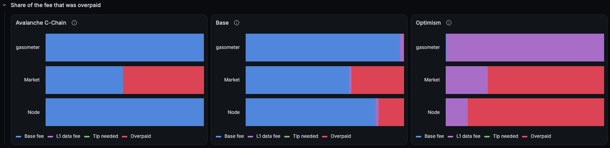
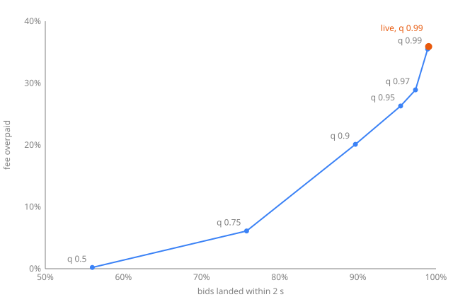

# gasometer's first clean week

One week of the live service, 2026-11-04 15:00 to 2026-11-11 15:00 UTC, with no restart or outage inside it. Every minute, on each network, four predictors bid for a native transfer (21,000 gas) to land within 2, 30 and 120 seconds: 10,080 bids per predictor, horizon and network.



*Share of the fee that was overpaid, 30 second horizon, over the week. Live on the [public dashboard](https://ionsie.grafana.net/public-dashboards/f7aee50b6bb34f9e92f94ec700509cf8).*

## 1. Window and method

| | |
| --- | --- |
| Window | 2026-11-04 15:00 to 2026-11-11 15:00 UTC |
| Bids | 10,080 per predictor, horizon and network; 10,074 to 10,080 resolved |
| Transaction | Native transfer, 21,000 gas |
| Landed | Included ÷ resolved |
| Mean fee | Mean USD cost of a landed bid: (paid per gas × 21,000 + L1 data fee) × the coin's USD price at the snapshot |
| Overpaid | Sum of overpay ÷ sum of fee paid, over landed bids, in USD. The dashboard computes the same ratio |

A bid lands if some block in its horizon has a required tip at or below the bid's tip, and a base fee its max fee covers. The required tip is a percentile of the tips a block included: the 5th on Base and OP, the 0th on C-Chain. That is an upper bound on what inclusion needed, so a landed share is a lower bound. Horizons are quoted in seconds because the number of blocks in each is derived from the observed block rate.

## 2. Results

### 2 seconds

| Network | Predictor | Landed | Mean fee | Overpaid |
| --- | --- | --- | --- | --- |
| Avalanche C-Chain | `market` | 84.31% | $0.0014 | 53.1% |
| | `node` | 52.49% | $0.00063 | 0.0% |
| | `wallet` | 54.11% | $0.00063 | 0.0% |
| | `gasometer` | 99.06% | $0.0011 | 35.9% |
| Base | `market` | 99.57% | $0.00037 | 33.0% |
| | `node` | 99.98% | $0.00029 | 15.5% |
| | `wallet` | 99.98% | $0.00029 | 15.5% |
| | `gasometer` | 99.11% | $0.00027 | 7.8% |
| Optimism | `market` | 98.47% | $0.000029 | 73.6% |
| | `node` | 99.99% | $0.000055 | 86.1% |
| | `wallet` | 99.99% | $0.000055 | 86.1% |
| | `gasometer` | 99.00% | $0.0000080 | 4.8% |

### 30 seconds

| Network | Predictor | Landed | Mean fee | Overpaid |
| --- | --- | --- | --- | --- |
| Avalanche C-Chain | `market` | 99.71% | $0.0013 | 51.1% |
| | `node` | 99.12% | $0.00064 | 0.4% |
| | `wallet` | 99.95% | $0.00065 | 0.5% |
| | `gasometer` | 99.92% | $0.00065 | 0.5% |
| Base | `market` | 100.00% | $0.00037 | 33.2% |
| | `node` | 99.99% | $0.00029 | 16.0% |
| | `wallet` | 99.99% | $0.00029 | 16.0% |
| | `gasometer` | 99.92% | $0.00025 | 0.3% |
| Optimism | `market` | 99.98% | $0.000029 | 73.5% |
| | `node` | 100.00% | $0.000055 | 86.1% |
| | `wallet` | 100.00% | $0.000055 | 86.1% |
| | `gasometer` | 99.01% | $0.0000080 | under 0.1% |

### 120 seconds

| Network | Predictor | Landed | Mean fee | Overpaid |
| --- | --- | --- | --- | --- |
| Avalanche C-Chain | `market` | 99.97% | $0.0013 | 51.4% |
| | `node` | 99.33% | $0.00064 | 1.0% |
| | `wallet` | 99.99% | $0.00065 | 1.1% |
| | `gasometer` | 99.36% | $0.00065 | 1.2% |
| Base | `market` | 100.00% | $0.00037 | 33.4% |
| | `node` | 99.99% | $0.00029 | 16.2% |
| | `wallet` | 100.00% | $0.00029 | 16.2% |
| | `gasometer` | 99.96% | $0.00025 | 0.4% |
| Optimism | `market` | 100.00% | $0.000029 | 73.5% |
| | `node` | 100.00% | $0.000055 | 86.1% |
| | `wallet` | 100.00% | $0.000055 | 86.1% |
| | `gasometer` | 98.95% | $0.0000080 | under 0.1% |

`wallet` bids the node's tip with a max fee of twice the next base fee, so it lands wherever `node` does and also where the base fee rises within the horizon. That only shows on C-Chain, where it lands 1.6 points more often at 2 seconds.

## 3. What each network shows

- **Optimism:** the node suggests a 0.001 gwei tip against a median base fee of 385 wei and a median required tip of 29 wei. 86% of what `node` and `wallet` pay is tip that bought nothing, so a transfer costs 7 times what landed. `gasometer` pays one seventh of that and lands 99% of bids at every horizon.
- **Optimism at 2 seconds:** `gasometer` overpays 4.8% in aggregate and 0% for the median bid. It bids under 1,000 wei 96.6% of the time; a short burst of blocks needing 0.001 gwei or more lifts its 0.99 quantile until the burst ages out of its history. The 59 bids it makes in that state, 0.6% of the total, carry 75% of its overpay. `market` shows the same shape: 73.6% in aggregate, 0.2% for the median bid, because the latest block's median tip is usually near zero and occasionally 0.005 gwei.
- **Base:** `node` overpays by a sixth and `market` by a third, at every horizon. `gasometer` is within 0.5% of the cheapest landing fee at 30 and 120 seconds, and 7.8% at 2 seconds.
- **C-Chain:** the node's 150 wei tip is the cheapest any block includes, so `node` never overpays, but only 29.8% of blocks include a tip that low and its bids land within 2 seconds 52.5% of the time. From 30 seconds on it lands over 99%. `market` pays twice what landed at every horizon.
- **C-Chain at 2 seconds:** `gasometer` lands 99.06% of bids and pays 35.9% more than the cheapest landing fee. Section 4 covers why.
- **The fee models** matched each node's next base fee on every poll on every network.

## 4. C-Chain at 2 seconds

A 2 second horizon on C-Chain is two blocks. To land 99% of the time, the bid has to cover the cheaper of the next two blocks' required tips 99% of the time, and that tip ranges from 150 wei to tens of gwei:

| Required tip | Value |
| --- | --- |
| Blocks at exactly 150 wei | 25.9% |
| Blocks at 150 wei or less | 29.8% |
| Median block | 0.1 gwei |
| 99th percentile of the cheaper of two blocks | 3.75 gwei |
| `gasometer`'s median bid | 1.5 gwei |

Replaying the predictor over the same week's 619,084 C-Chain blocks reproduces the live result: 98.93% landed and 35.5% overpaid, against 99.06% and 35.9% live. Lowering the quantile trades landing for cost along one curve:



| Quantile | Landed | Overpaid |
| --- | --- | --- |
| 0.50 | 56.0% | 0.2% |
| 0.75 | 75.8% | 6.1% |
| 0.90 | 89.7% | 20.1% |
| 0.95 | 95.5% | 26.3% |
| 0.97 | 97.4% | 28.9% |
| 0.99 | 98.9% | 35.5% |
| Live, 0.99 | 99.1% | 35.9% |

**The window length does not matter.** At a 0.99 quantile, every history from 300 to 3,600 windows lands between 98.7% and 98.9% and overpays between 35.5% and 35.6%. Thirty windows are too few to resolve a 0.99 quantile and land 96.6%.

**No rule on recent history does much better.** When the cheaper of two blocks is in its most expensive 10%, the same is true 2 to 120 blocks later only 15% to 18% of the time, against a 10% base rate. Expensive windows barely cluster, so a predictor cannot tell when to bid high and has to bid for the tail every time.

**The overpay is the price of a target set against an upper bound.** Blocks are 1.8% full on average, so a block's required tip is set by whichever few transactions it happened to hold, not by competition for space. A block holding one 1 gwei transfer scores as needing 1 gwei, though a 150 wei bid might well have landed in it. Reaching 99% as scored means covering those blocks; what 99% inclusion really costs is likely lower. [Probe transactions](../README.md#roadmap) will measure it.

## 5. Service health

| Check | Result |
| --- | --- |
| Polls | 10,080 snapshots per network: every minute of the week |
| Fee model mismatches | 0 on every network |
| Log lines | None from the service in the window, at any level |
| C-Chain `eth_feeHistory` retries | 177 between the 2026-11-04 14:30 restart and 2026-11-11, each recovered within its poll |
| Expired bids | 8 per predictor on Optimism, 6 at 2 seconds and 2 at 30 seconds; none elsewhere |
| Unresolvable bids | 0 |
| Bids with no USD price | 0 |

The retries are C-Chain's load-balanced endpoint reporting a head that a follow-up `eth_feeHistory` cannot find yet. The RPC client retries that response, so no poll was lost to it.

C-Chain blocks 99,278,792 to 99,285,853 (7,062 blocks) were lost during an outage on 2026-11-01 to 11-03, beyond the RPC's history depth. They predate the window and affect none of these numbers.

## 6. Reproducing

The results tables come from one query against the service's Postgres:

```sql
WITH w AS (
  SELECT p.network, p.predictor, p.horizon_seconds AS h, p.status, p.included,
         p.paid_per_gas, p.overpay_per_gas, s.native_usd,
         COALESCE((s.l1_fees->>'native')::numeric, 0) AS l1
  FROM predictions p JOIN snapshots s ON s.id = p.snapshot_id
  WHERE s.observed_at >= '2026-11-04 15:00Z' AND s.observed_at < '2026-11-11 15:00Z'
), c AS (
  SELECT *, (paid_per_gas * 21000 + l1) * native_usd / 1e18 AS paid_usd,
            overpay_per_gas * 21000 * native_usd / 1e18 AS over_usd
  FROM w WHERE status = 'resolved'
)
SELECT h, network, predictor,
       count(*) AS bids,
       round(100.0 * count(*) FILTER (WHERE included) / count(*), 2) AS landed,
       round(avg(paid_usd) FILTER (WHERE included), 6) AS fee_usd,
       round(100 * sum(over_usd) FILTER (WHERE included) / sum(paid_usd) FILTER (WHERE included), 1) AS overpaid
FROM c GROUP BY 1, 2, 3 ORDER BY 1, 2, 3;
```

The backtest replays the predictor's rule over the `blocks` table: for each minute, the 0.99 quantile of the cheapest required tip in each of the last 1,800 two-block windows, scored against the next two blocks.
