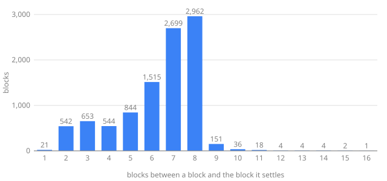
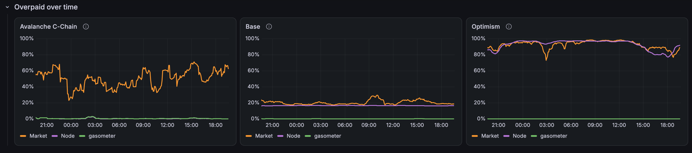

# How the C-Chain base fee works under SAE

Avalanche C-Chain runs Streaming Asynchronous Execution (SAE, [ACP-194][acp-194]), active on mainnet since the Helicon upgrade at 15:00 UTC on 22 September 2026 ([`upgrade.go`][helicon]). Its base fee no longer follows EIP-1559: it comes from a gas clock that every node replays from the last settled block. This document explains why SAE prices that way, how the clock works, the worst-case bound gasometer builds on it, what mainnet actually shows and what the RPC returns. Each claim is checked against mainnet.

Code links and snippets are from [avalanchego v1.15.2](https://github.com/ava-labs/avalanchego/tree/v1.15.2/vms/saevm), under `vms/saevm/` unless the path says otherwise.

## Notation

| Symbol | Meaning | Source |
| --- | --- | --- |
| $x$ | gas excess, the clock's state | [`Time.excess`][gastime-price] |
| $T$ | target gas per second | [`TargetExponent.Target`][target] |
| $R = 2T$ | gas per second the clock runs at | [`TargetToRate`][target-to-rate] |
| $K = 87\,T$ | excess scaling factor | [`GasConfigAfter`][gas-config-after] |
| $p_{\min}$ | minimum gas price | [`PriceExponent.Price`][price] |
| $\tau = 5\ \text{s}$ | settlement delay | [`TauSeconds`][params] |
| $\lambda = 2$ | a transaction is charged at least its gas limit $/ \lambda$ | [`Lambda`][params] |

## 1. Why SAE exists

A synchronous chain executes a block and then agrees on it. Each node alternates between the two jobs, so execution sits idle while consensus runs and consensus waits while execution runs. [ACP-194][acp-194]'s first motivation is exactly this: "VM time" is eroded by consensus, so the chain gets less gas per wall-second than its executor could deliver.

SAE separates the two. Consensus agrees only on which transactions run and in what order, which fixes the result, and puts the accepted block on a FIFO queue. An executor on every node drains that queue continuously: "as soon as there is a block available in the execution queue, the block executor starts processing the block". A later block records the results.

| Stage | What happens |
| --- | --- |
| Proposed | The builder picks transactions without executing them, checking only that each sender can pay its worst case |
| Accepted | Consensus agrees on the block, and it joins the execution queue |
| Executed | The executor runs it on the last executed state. Receipts exist from here |
| Settled | A block at least $\tau$ later records its state root and the receipts since the last settlement |

What this buys, per [ACP-194][acp-194]: execution and consensus run concurrently; a one-off stall such as a database compaction is spread over several blocks instead of delaying one; throughput can burst above the target; and clients that only execute can run ahead of the network without computing state roots. Settlement delay does not delay users: $\tau$ "has no effect on the availability nor finality of results, both of which are immediate at the time of executing an individual transaction" ([`params.go`][params]).

The executor runs flat out only when the queue has work in it. Section 6 shows how much work mainnet gives it.

## 2. Why SAE needs a different fee model

The cost of separating consensus from execution is that a builder no longer knows what the queue will use. When a block is built, the blocks ahead of it may not have executed, so nobody knows their gas used. EIP-1559 sets the next base fee from the parent's gas used, which SAE does not have in time. Four design choices follow.

**Gas measures time.** [ACP-176][acp-176] already defines $R$, the gas per second the chain can sustain. Turned around, $g$ gas takes $g/R$ seconds. So the executor timestamps every block's start and end from the gas it consumed, and every node computes the same timestamps without trusting its own wall clock. Settlement and pricing both depend on those timestamps, which is why they are deterministic.

**Price on the worst case.** The price is a non-decreasing function of the gas used by the blocks ahead in the queue, so assuming every transaction uses its full gas limit gives the highest price any block could face. A block is valid only if every sender can pay that worst case, which makes acceptance a guarantee of settlement: consensus never admits a transaction whose fee cannot be paid. The header carries that bound, set straight from the worst-case state ([`sae/block_builder.go`][block-builder-basefee]):

```go
hdr.GasLimit = state.GasLimit()
hdr.BaseFee = state.BaseFee().ToBig()
```

**Charge at least half the limit.** Pricing on gas limits opens an attack: a transfer that uses 21,000 gas but declares a limit of a full block inflates everyone's worst case and pays for almost none of it. So SAE charges $g_C = \max\left(g_U, \lceil g_L / \lambda \rceil\right)$ ([`hook.MinimumGasConsumption`][min-gas-consumption]), applied in libevm's [`afterGasRefund`][after-gas-refund]. With $\lambda = 2$ a sender can leave a 100% buffer on their gas estimate without paying for it, while an inflated limit costs real money.

**Delay settlement by $\tau$.** Settling a block only once its execution finished at least 5 s earlier spreads a sporadic slowdown over several blocks: a stall pushes back when results are recorded, not when blocks are accepted. Capacity can then be set for typical execution speed rather than the slowest moment.

## 3. The gas clock

The clock ([`gastime.Time`][gastime-price]) tracks the excess $x$, and its price is

$$
p = \max\left(p_{\min},\ e^{x/K}\right), \qquad K = 87\,T
$$

```go
func (tm *Time) Price() gas.Price {
	p := calculatePrice(tm.excess, tm.excessScalingFactor())
	// When minPrice can't be represented by e^(x/k), p may be too low.
	return max(tm.config.MinPrice, p)
}
```

The exponential is [`gas.CalculatePrice`][calculate-price], the integer Taylor-series approximation from EIP-4844 (`fake_exponential`). The 87 is C-Chain's choice, set per block in [`cchain/hooks.go`][gas-config-after]:

```go
return te.Target(), gastime.GasPriceConfig{
	TargetToExcessScaling: 87, // 87 ~= 60 / ln(2)
	MinPrice:              priceExponent(header).Price(),
}
```

Two operations move the clock.

**[`Tick`][tick] charges $g$ gas.** Gas time advances by $g/R$, and the excess rises by the share of that gas above the target:

$$
\Delta x = g \cdot \frac{R - T}{R} = \frac{g}{2}
$$

```go
R, T := tm.Rate(), tm.Target()         //nolint:revive // unexported-naming: mathematical convention
quo, _, _ := intmath.MulDiv(g, R-T, R) // overflow is impossible as (R-T)/R < 1
tm.excess = intmath.BoundedAdd(tm.excess, quo, math.MaxUint64)
```

**[`FastForwardTo`][fast-forward] moves gas time up to wall time** if it is behind, and every second skipped drains the target:

$$
\Delta x = -T \cdot \Delta t
$$

```go
// -sT
if s := gas.Gas(sec); tm.excess/T >= s { // sT <= x; division is safe because T > 0
	tm.excess -= s * T
} else { // sT > x
	tm.excess = 0
}
```

This is the feedback loop. Demand above $T$ puts gas time ahead of wall time and raises the price, and the higher price thins out what builders can include. Demand below $T$ lets wall time catch up and drains the excess. At full throughput the clock is fed $R$ gas per second, so the excess grows by $(R - T) = T$ per second, and the price doubles when the exponent grows by $\ln 2$:

$$
\Delta t_{\times 2} = \frac{K \ln 2}{T} = 87 \ln 2 \approx 60\ \text{s}
$$

**Under sustained full blocks the C-Chain base fee doubles every 60 seconds, and when idle it halves every 60 seconds.** That is what the comment on the 87 means.

### Why there is a floor

Halving every idle minute would take the price towards 1 wei, and [ACP-176][acp-176] originally set the minimum there. [ACP-283][acp-283] explains what happened next: at near-zero prices spam such as XEN, which mines proof of work on-chain, stayed profitable and kept the chain full of low-value transactions. So the minimum price became a validator vote. After each block, [`enforceMinExcess`][enforce-min-excess] raises $x$ to at least the excess that prices $p_{\min}$, so the clock never starts a block below the floor, and the floor binds whenever organic demand is too low to push the clock above it.

### Why parameters move slowly

The target and the minimum price are set per block, as exponents in the header (`cchain/dynamic`). Each validator configures the value it wants, the builder of each block moves the exponent towards its own preference, and over many blocks the network converges on the stake-weighted median. Each block may move them by at most a capped step, so no single builder can jolt the price. The target's step is $2^{15}$ ([`TargetExponent.Toward`][target-toward]):

```go
func (t TargetExponent) Toward(desired *TargetExponent) TargetExponent {
	// Per ACP-176, the per-block exponent change is capped at 2^15.
	const maxDiff = 1 << 15
	return toward(t, desired, maxDiff)
}
```

With the target's conversion rate of $2^{25}$, that moves $T$ by at most a factor of $e^{2^{15}/2^{25}} = e^{1/1024}$ per block. The minimum price's step is a 3,600th of a doubling ([`PriceExponent.Toward`][price-toward]), so it takes about an hour of one-second blocks to double or halve:

```go
func (p PriceExponent) Toward(desired *PriceExponent) PriceExponent {
	const (
		diffToDouble   = 288_230_376_151_711_744 // conversionRate * ln(2)
		blocksToDouble = 3_600
		maxDiff        = diffToDouble / blocksToDouble
	)
	return toward(p, desired, maxDiff)
}
```

That moves $p_{\min}$ by at most $2^{1/3600} \approx 1.000193$ per block.

When the target changes, [`AfterBlock`][after-block] rescales the excess so that $x/K$, and therefore the price, is unchanged, rounding up ([`scaleExcess`][scale-excess]). Changing the target changes capacity, not the price anyone pays at that moment:

$$
x' = \left\lceil x \cdot \frac{K'}{K} \right\rceil = \left\lceil x \cdot \frac{87\,T'}{87\,T} \right\rceil
$$

### What a burst of full blocks does

A full block is $\tau \lambda = 10$ seconds of gas at the clock's rate ([`SafeMaxBlockSize`][safe-max-block-size]):

```go
const (
	maxGasSecondsPerBlock = saeparams.TauSeconds * saeparams.Lambda
)
```

$$
g_{\max} = R \cdot \tau \lambda = 2T \cdot 10 = 20\,T, \qquad \Delta x = \frac{g_{\max}}{2} = 10\,T, \qquad \frac{p'}{p} = e^{10T/87T} = e^{10/87} \approx 1.122
$$

So each full block raises the fee by 12.2% at any target.


The figure simulates nine full blocks, one every 2 s. The gas clock runs 90 s ahead of the wall in 18 s, the fee rises to $e^{90/87} \approx 2.8$ times its start, and it stays there until the wall catches the gas clock. Only then does idle time drain the excess.

## 4. Settlement and the worst case

A block settles the last block whose execution finished at least $\tau$ before its own timestamp ([`sae/block_builder.go`][block-builder-settle], [`LastToSettleAt`][last-to-settle]):

```go
lastSettled, ok, err := blocks.LastToSettleAt(bTime.Add(-saeparams.Tau), parent)
```

Its header records the settled block's height and the clock as it stood after that block executed: `settledHeight`, `settledGasUnix`, `settledGasNumerator`, `settledExcess`. That settled clock is the last state every node agrees on, so it is where pricing starts.

To price a new block, a node starts from that settled clock and replays every block since through [`worstcase.State`][worstcase-start]. For each block it advances to the block's time, charges the sum of its transactions' gas limits, not their gas used, plus the gas of its atomic import and export transactions, and then applies the gas config the block's header sets for its successor ([`FinishBlock`][worstcase-finish]):

```go
func (s *State) FinishBlock() (*blocks.WorstCaseBounds, error) {
	target, gasCfg := s.hooks.GasConfigAfter(s.curr)
	if err := s.clock.AfterBlock(s.blockSize, target, gasCfg); err != nil {
```

gasometer's [`sae`](../sae/sae.go) package does the same replay with avalanchego's own `gastime`, `proxytime` and `cchain/dynamic`, and parses atomic transactions with `cchain/tx`.

How far back a block's settled block sits decides how many blocks the replay must fetch. The chart counts it for 10,000 consecutive mainnet blocks: 2,962 of them settled the block 8 behind them, 2,699 the block 7 behind, and none more than 16.



The peak follows from $\tau$. A block can only settle one whose execution finished at least 5 s before it, and C-Chain produces about one block a second, so 5 s plus the time execution takes puts the settled block 7 or 8 blocks back. When blocks come faster than usual more of them fit in that window, and when they pause fewer do, which spreads the count either side.

## 5. The worst-case bound

gasometer bids for landing within $k$ blocks, so it needs the highest base fee block $n+1+k$ can have, given the chain up to block $n$. A max fee at or above that ceiling cannot be outbid by the base fee within the horizon. [`sae.MaxBaseFeeAfter`](../sae/sae.go) runs the clock forward from the next block's bound through $k$ blocks, each of them full and each at the worst config its parent can step to, the minimum price up and the target down through avalanchego's own `Toward`. It then adds a rounding slack:

$$
\bar{p}_{n+1+k} = \left\lceil p^{\text{walk}}_k \cdot \left(1 + k \cdot 10^{-6}\right) \right\rceil
$$

```go
b := blocks[len(blocks)-1]
for range k {
	b.TargetExponent = uint64(dynamic.TargetExponent(b.TargetExponent).Toward(new(dynamic.TargetExponent)))
	b.MinPriceExponent = uint64(dynamic.PriceExponent(b.MinPriceExponent).Toward(new(dynamic.PriceExponent(math.MaxUint64))))
	target, cfg := gasConfig(b)
	if err := clock.AfterBlock(worstcase.SafeMaxBlockSize(clock.Rate()), target, cfg); err != nil {
		return nil, fmt.Errorf("full block: %w", err)
	}
}
return withRoundingSlack(price(clock), k), nil
```

Each part of that has a reason:

- **Full blocks with no time passing.** A full block is 10 s of gas, more than any block interval, so the gas clock stays ahead of the wall and `FastForwardTo` never drains anything. Each full block multiplies the fee by $e^{10/87} \approx 1.122$ at any target, as derived above.
- **The minimum price never binds.** It rises at most $2^{1/3600} \approx 1.0002$ per block against the clock's $1.122$, and the clock starts at or above it, so $e^{x/K}$ stays above $p_{\min}$ throughout.
- **The target only matters through rounding.** `scaleExcess` keeps $x/K$ across a target change but rounds up, and `CalculatePrice` approximates the exponential. Over 4,000 random futures (random settled clocks, target and minimum price walks within the `Toward` caps, block gas up to the limit, time advancing) the realised fee exceeded the bound without slack by at most $2.7 \times 10^{-9}$ per block. The $10^{-6}$ per block slack covers that about 370 times over, and overstates the ceiling by 0.012% at 120 blocks.

The slack is necessary. Without it, a target falling at the maximum rate under full blocks beats a fixed-config bound by 6 wei at $k = 1$, and a target falling 1,000 exponent units per block beats the walked bound by 1,282 wei at $k = 30$. The config walk is not the worst rounding path: it states the worst config the protocol can reach, and the slack is what keeps the bound strict.

On mainnet the bound held for every block it covered. The tightest case at each horizon, for 10,000 recent blocks at the floor and for 60,000 blocks from SAE's first week, when the clock set every fee:

| Smallest $\bar{p}_{n+1+k} / p_{n+1+k}$ | $k = 1$ | 2 | 30 | 120 |
| --- | --- | --- | --- | --- |
| Recent, at the floor | 1.0195 | 1.0451 | 20.94 | 654,192 |
| First week, above the floor | 1.0000 | 1.0244 | 4.32 | 1,621 |

When blocks are full the bound is met almost exactly: in the first week the fee one block on came within 0.005% of it, and two blocks on within 2.5%. Over minutes it is useless as a forecast, because nothing forces blocks to be full ($1.122^{120} \approx 10^{6}$); gasometer uses it only as a cap on its own projection.

## 6. What mainnet shows

The clock decides the fee only when demand pushes it above the floor. On mainnet that has rarely happened since SAE's first days. The table samples 30 consecutive blocks a day, from two weeks before activation to 27 October, read from the public endpoint. The target $T$ was 4M gas/s throughout, carried over unchanged from [ACP-176][acp-176], so $R$ was 8M gas/s.

| Period | $p_{\min}$ | Base fee | Mean gas/s |
| --- | --- | --- | --- |
| 9 to 22 Sep, before SAE | 1 wei | 0.05 to 0.10 gwei | 3.8M |
| 23 to 30 Sep | 1 wei, rising from 24 Sep to 5 gwei by 28 Sep | set by the clock until 26 Sep, peaking at 158.5 gwei; then at or just above the floor | 5.9M |
| 1 to 18 Oct | 5 gwei | at or just above the floor | 1.6M |
| 19 to 27 Oct | 2.5 gwei | at or just above the floor | 1.3M |

Before SAE, gas use averaged about the target while the fee stayed near 0.05 gwei. [ACP-283][acp-283] gives the reason: spam demand kept [ACP-176][acp-176]'s price discovery from pushing the price any lower, so the chain sat at its target at almost no cost. For the first three and a half days of SAE, demand exceeded $T$ and the clock, not the floor, set the fee: a sample every 1,000 blocks from activation found every block above the floor until 26 September. Bursts drove it from around 0.05 gwei to 13.5 gwei on 23 September and 158.5 gwei on 24 September. Once validators had voted the floor to 5 gwei, about 100 times the pre-SAE base fee, gas use fell by more than half. That is what [ACP-283][acp-283] set out to do. Routescan's [daily C-Chain charts](https://snowtrace.io/insight/chart?id=txnfees&metrics=ecosystem%3Aavalanche%3AFees%3A%23ef9b20%3Aday%3Alinear%3Aline%3Avisible%3Ay1%3Anone%3A%2Cchain%3A43114%3AFees%3A%2327aeef%3Aday%3Alinear%3Aline%3Avisible%3Ay1%3Anone%3Asymbol&zoom=1year) show the same step in gas used, from about 4M gas/s before to about 1M by mid-October.

Over 300 blocks on 27 October the chain used 0.75M gas/s, 9.4% of $R$, and 270 of the 300 blocks paid exactly the floor. So the executor idles most of the time, and the base fee is the validators' floor vote rather than anything the clock computed. Two consequences for fee estimation:

- **The tip barely decides inclusion.** Blocks are nowhere near full, so any tip the builder accepts gets in. This is the overpay gasometer measures.
- **The clock and the bound in section 5 matter in bursts.** A burst of full blocks starts from the floor and raises the fee 12.2% a block. SAE's first days are the only sustained period so far in which the clock set the price, and section 8 replays them.

gasometer measures that overpay live, on its [public dashboard](https://ionsie.grafana.net/public-dashboards/f7aee50b6bb34f9e92f94ec700509cf8). Over the 24 hours to 29 October, a bid at the median tip on C-Chain overpaid by between about 20% and 70%, while the node's suggestion and gasometer's own bid stayed within a few percent of the cheapest bid that landed.



*Share of each bid's fee paid above the cheapest bid that landed within 30 seconds, over a trailing hour, 28 to 29 October 2026.*

The table and the samples come from one-off scripts against the public endpoint, not from the tests in section 8; the peak fees do come from those tests.

## 7. What the RPC returns

Three numbers look like "the next base fee", and they differ.

**`eth_baseFee`** returns the last accepted block's worst-case bound at its latest end time ([`estimateNextBaseFee`][estimate-next-base-fee]):

```go
func (c *customAPI) estimateNextBaseFee() *big.Int {
	bounds := c.b.LastAccepted().WorstCaseBounds()
	if bounds == nil {
		return c.b.LastAccepted().EthBlock().BaseFee()
	}
	return bounds.LatestEndTime.BaseFee().ToBig()
}
```

**A block header's `baseFeePerGas`** is the builder's bound at the block's build time, set as shown in section 2. builders-hub documents both of these as worst-case bounds.

**The last element of `eth_feeHistory`'s `baseFeePerGas`** is one of two different things ([`FeeHistory`][fee-history-branch]). If the newest block requested is the last accepted block, it is that block's bound, as `eth_baseFee` returns. Otherwise it is the header fee of the block after the newest:

```go
if last == lastAcceptedNumber {
	bounds := lastAccepted.WorstCaseBounds()
	if bounds == nil {
		baseFee = append(baseFee, lastAccepted.EthBlock().BaseFee())
	} else {
		baseFee = append(baseFee, bounds.LatestEndTime.BaseFee().ToBig())
	}
} else if b := e.blockCache.getBlock(last + 1); b != nil {
	baseFee = append(baseFee, b.baseFee)
} else {
	return nil, nil, nil, nil, fmt.Errorf("%w: %d", errMissingBlock, last+1)
}
```

So the element depends on which node answers and when, not only on the request. The root cause is SAE's split between acceptance and execution: `latest` resolves to the last **executed** block, not the last accepted one ([`ResolveRPCNumber`][resolve-rpc-number]), and `eth_blockNumber` returns the same height:

```go
case rpc.LatestBlockNumber:
	return c.LastExecuted().Height(), nil
```

Even on one node, then, `eth_feeHistory(n, "latest")` takes the second branch whenever execution trails acceptance. `FeeHistory` also reads the requested block and the [last accepted block][fee-history-last-accepted] separately, so a block accepted mid-call has the same effect. Both are rare on one node. The common case is a load-balanced endpoint: a client reads the latest block from one node, asks another for fee history up to it, and the second node has already accepted the next block.

In go-ethereum the element is a pure function of the newest block ([`eth/gasprice/feehistory.go`][geth-fee-history], here as vendored in libevm), and legacy coreth returned no next element at all:

```go
bf.results.nextBaseFee = eip1559.CalcBaseFee(chainconfig, bf.header)
```

Neither value is what the block will actually pay. Both are upper bounds, and the executed fee ([`ExecutedBaseFee`][executed-base-fee]) is no higher than either.

## 8. Validation

All of these figures come from tests in this repository that run against the public endpoint (`go test -tags live ./rpc`): [`live_replay_sae_test.go`](../rpc/live_replay_sae_test.go) and [`live_feehistory_sae_test.go`](../rpc/live_feehistory_sae_test.go). The replay checks the 10,000 blocks before the head by default; `GASOMETER_SAE_REPLAY_END` and `GASOMETER_SAE_REPLAY_BLOCKS` point it at any other window.

The replay ran over recent blocks, where the floor sets the fee, and over three windows of 20,000 blocks from SAE's first week (95,975,001 to 95,995,000, 96,070,001 to 96,090,000 and 96,120,001 to 96,140,000), where the clock set every fee.

| Replay check | Recent, 98,696,168 to 98,706,167 | First week, 3 windows |
| --- | --- | --- |
| Base fee replayed exactly | 10,000 of 10,000 | 60,000 of 60,000 |
| Blocks priced above $p_{\min}$ | 2,610 of 10,000, peak 3.8 gwei | 60,000 of 60,000, peak 158.5 gwei |
| Windows containing atomic transactions, all exact | 150 | 1,189 |
| Mutation: transaction gas limits zeroed | 2,610 mismatch | 59,900 mismatch |
| Mutation: atomic gas zeroed | 31 of 150 atomic windows mismatch | 988 of 1,189 mismatch |
| Ceiling at $k$ = 1, 2, 30, 120 against the realised fee | never below it | never below it |

| RPC check | Result |
| --- | --- |
| `eth_feeHistory` next base fee, two requests (latest block, then history up to it), 199 samples | the successor's header fee in 40, every one with the successor already accepted on the node that answered |
| `eth_feeHistory(1, "latest")` against `eth_baseFee`, one node in one batch, 199 samples | different in 1 |

The mutations show that both inputs matter, and how much the floor hides. Over recent blocks, dropping transaction gas limits breaks exactly the 2,610 base fees priced above the floor: removing gas can only lower the fee, and at the floor it cannot go lower. When the clock sets every fee it breaks 99.8% of them, and dropping atomic gas breaks 83% of the windows that contain atomic transactions.

The two-request samples read the latest block $E$, then ask in one batch for block $E+1$ and `eth_feeHistory(1, E)`. A node runs a batch in order, and a block number above its last accepted one fails with "not accepted yet", so whether $E+1$ resolves says which branch `FeeHistory` took; in every sample the value was the one that branch serves. Through `api.avax.network` a client that reads the latest block and then `eth_feeHistory` gets the successor's header fee about one time in five. On a single node, execution trailing acceptance accounts for about one in two hundred.

## 9. What a wallet should do

- **Bid on `eth_baseFee`, not on the tail of `eth_feeHistory`.** `eth_baseFee` is always the same bound. Through a load-balanced endpoint, the tail of `eth_feeHistory` is a different number about one time in five, depending on which node answers. The fee actually charged is no higher than the bound, so a max fee set from it will not be outbid by the base fee within the next block. For a transaction meant to land within $k$ blocks, the bound in section 5 gives the max fee that is certain to cover the base fee.
- **Keep the gas limit within twice the expected gas used.** SAE charges at least half the limit, so padding an estimate by more than 100% is paid for.
- **Expect the floor.** While demand stays below the target, the base fee is $p_{\min}$, and only the tip is left to overpay.

[acp-176]: https://github.com/avalanche-foundation/ACPs/tree/main/ACPs/176-dynamic-evm-gas-limit-and-price-discovery-updates
[acp-194]: https://github.com/avalanche-foundation/ACPs/tree/main/ACPs/194-continuous-execution
[acp-283]: https://github.com/avalanche-foundation/ACPs/tree/main/ACPs/283-dynamic-minimum-gas-price
[after-block]: https://github.com/ava-labs/avalanchego/blob/v1.15.2/vms/saevm/gastime/acp176.go#L44-L67
[after-gas-refund]: https://github.com/ava-labs/libevm/blob/2c4d255e0a63/core/state_transition.libevm.go#L119-L150
[block-builder-basefee]: https://github.com/ava-labs/avalanchego/blob/v1.15.2/vms/saevm/sae/block_builder.go#L248-L249
[block-builder-settle]: https://github.com/ava-labs/avalanchego/blob/v1.15.2/vms/saevm/sae/block_builder.go#L409
[calculate-price]: https://github.com/ava-labs/avalanchego/blob/v1.15.2/vms/components/gas/gas.go#L85
[enforce-min-excess]: https://github.com/ava-labs/avalanchego/blob/v1.15.2/vms/saevm/gastime/acp176.go#L97-L109
[estimate-next-base-fee]: https://github.com/ava-labs/avalanchego/blob/v1.15.2/vms/saevm/sae/rpc/custom.go#L46-L52
[executed-base-fee]: https://github.com/ava-labs/avalanchego/blob/v1.15.2/vms/saevm/blocks/execution.go#L252-L254
[fast-forward]: https://github.com/ava-labs/avalanchego/blob/v1.15.2/vms/saevm/gastime/gastime.go#L173-L212
[fee-history-branch]: https://github.com/ava-labs/avalanchego/blob/v1.15.2/vms/saevm/gasprice/estimator.go#L309-L320
[fee-history-last-accepted]: https://github.com/ava-labs/avalanchego/blob/v1.15.2/vms/saevm/gasprice/estimator.go#L262-L267
[gas-config-after]: https://github.com/ava-labs/avalanchego/blob/v1.15.2/vms/saevm/cchain/hooks.go#L180-L198
[gastime-price]: https://github.com/ava-labs/avalanchego/blob/v1.15.2/vms/saevm/gastime/gastime.go#L129-L135
[geth-fee-history]: https://github.com/ava-labs/libevm/blob/2c4d255e0a63/eth/gasprice/feehistory.go#L87
[helicon]: https://github.com/ava-labs/avalanchego/blob/v1.15.2/upgrade/upgrade.go#L41
[last-to-settle]: https://github.com/ava-labs/avalanchego/blob/v1.15.2/vms/saevm/blocks/settlement.go#L178
[min-gas-consumption]: https://github.com/ava-labs/avalanchego/blob/v1.15.2/vms/saevm/hook/hook.go#L215-L221
[params]: https://github.com/ava-labs/avalanchego/blob/v1.15.2/vms/saevm/params/params.go#L15-L27
[price]: https://github.com/ava-labs/avalanchego/blob/v1.15.2/vms/saevm/cchain/dynamic/price.go#L22-L37
[price-toward]: https://github.com/ava-labs/avalanchego/blob/v1.15.2/vms/saevm/cchain/dynamic/price.go#L39-L50
[resolve-rpc-number]: https://github.com/ava-labs/avalanchego/blob/v1.15.2/vms/saevm/blocks/access.go#L124-L136
[safe-max-block-size]: https://github.com/ava-labs/avalanchego/blob/v1.15.2/vms/saevm/worstcase/state.go#L145-L155
[scale-excess]: https://github.com/ava-labs/avalanchego/blob/v1.15.2/vms/saevm/gastime/acp176.go#L69-L87
[target]: https://github.com/ava-labs/avalanchego/blob/v1.15.2/vms/saevm/cchain/dynamic/target.go#L23-L33
[target-to-rate]: https://github.com/ava-labs/avalanchego/blob/v1.15.2/vms/saevm/gastime/gastime.go#L91
[target-toward]: https://github.com/ava-labs/avalanchego/blob/v1.15.2/vms/saevm/cchain/dynamic/target.go#L35-L43
[tick]: https://github.com/ava-labs/avalanchego/blob/v1.15.2/vms/saevm/gastime/gastime.go#L156-L169
[worstcase-finish]: https://github.com/ava-labs/avalanchego/blob/v1.15.2/vms/saevm/worstcase/state.go#L330-L343
[worstcase-start]: https://github.com/ava-labs/avalanchego/blob/v1.15.2/vms/saevm/worstcase/state.go#L111-L123
