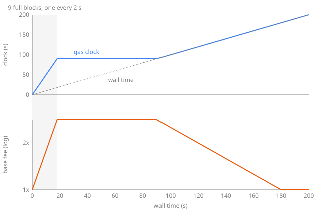

# How the C-Chain base fee works under SAE

Avalanche C-Chain runs Streaming Asynchronous Execution (SAE, [ACP-194](https://github.com/avalanche-foundation/ACPs/tree/main/ACPs/194-continuous-execution)). Its base fee no longer follows EIP-1559: it comes from a gas clock that every node replays from the last settled block. This document describes that clock, the worst-case bound gasometer builds on it, and what the RPC returns, and it checks each claim against mainnet. Code references are to [avalanchego](https://github.com/ava-labs/avalanchego) v1.15.2, under `vms/saevm/` unless the path says otherwise.

## 1. Why SAE needs a different fee model

Under SAE a block is accepted before it is executed. Consensus orders transactions, and execution follows in a queue behind it, so when a block is built nobody knows how much gas its transactions will use, or how much the blocks ahead of it in the queue used. EIP-1559 sets the next base fee from the parent's gas used, which SAE does not have in time.

SAE therefore prices on what is known at build time. A block's base fee is fixed when it is built, from a clock that charges every queued block its worst case, and ACP-194 requires the header's fee to be that worst-case bound at the moment execution starts (`sae/block_builder.go`, where `hdr.BaseFee` is set from `worstcase.State`).

## 2. The gas clock

The clock (`gastime/gastime.go`, `Time`) tracks an excess of gas x over a target rate T. The clock runs at R = 2T gas per second (`TargetToRate`), and the price is

> price = max(MinPrice, e^(x/K)), with K = 87T

computed by `gas.CalculatePrice` as an integer approximation. On C-Chain the scaling 87 is set in `cchain/hooks.go` with the note `87 ~= 60 / ln(2)`. Two operations move the clock:

- **`Tick(g)`** charges g gas. Gas time advances by g/R, and excess rises by g(R − T)/R, which is g/2.
- **`FastForwardTo(t)`** moves gas time up to wall time t if it is behind. Every second of idle time removes T of excess.

So at full throughput excess grows by T per second, and the price doubles when x grows by K·ln 2 ≈ 60T: **under sustained full blocks the C-Chain base fee doubles every 60 seconds, and when idle it halves every 60 seconds.** `enforceMinExcess` keeps x at least at the excess that prices MinPrice, so the price never starts below the minimum.

The target and the minimum price are themselves set per block, as exponents in the header (`cchain/dynamic`), and each can move only a capped step per block (`Toward`): the target by 2^15 in its exponent, a factor of e^(1/1024), and the minimum price by `diffToDouble / blocksToDouble`, which doubles it over 3,600 blocks. When the target changes, `scaleExcess` rescales x so that x/K, and therefore the price, is unchanged, rounding up.

The figure simulates nine full blocks, one every 2 s. Each full block is 10 s of gas (`worstcase.SafeMaxBlockSize`: R × `TauSeconds` × `Lambda`, 5 s × 2), so the gas clock runs 90 s ahead of the wall in 18 s. The fee rises by 10/87 in the exponent per block, a factor of 1.122, and stays there until the wall catches the gas clock. Only then does idle time drain the excess.

## 3. Settlement and the worst case

A block settles the last block whose execution finished at least `Tau` (5 s) before its own timestamp (`blocks/settlement.go`, `LastToSettleAt`). Its header records the settled block's height and the clock as it stood after that block executed: `settledHeight`, `settledGasUnix`, `settledGasNumerator`, `settledExcess`.

To price a new block, a node starts from that settled clock and replays every block since (`worstcase.State`). For each block it advances to the block's time, then charges the sum of its transactions' gas limits, not their gas used, plus the gas of its atomic import and export transactions. Then it applies the gas config that block's header sets for its successor (`cchain/hooks.go`, `GasConfigAfter`). gasometer's `sae` package does the same replay with avalanchego's own `gastime`, `proxytime` and `cchain/dynamic`, and parses atomic transactions with `cchain/tx`.

How far back settlement reaches decides how many blocks the replay covers. Over 10,000 mainnet blocks the settled block lagged its block by:

| Lag (blocks) | 1 | 2 | 3 | 4 | 5 | 6 | 7 | 8 | 9 | 10 | 11 | 12 to 16 |
| --- | --- | --- | --- | --- | --- | --- | --- | --- | --- | --- | --- | --- |
| Blocks | 21 | 542 | 653 | 544 | 844 | 1,515 | 2,699 | 2,962 | 151 | 36 | 18 | 15 |

## 4. The worst-case bound

gasometer projects the base fee some blocks ahead, so it needs a ceiling: the highest base fee that block n+1+k can have, given the chain up to block n. `sae.MaxBaseFeeAfter` computes it by running the clock forward from the next block's bound through k blocks, each of them full and each at the worst config its parent can step to: the minimum price up and the target down, through avalanchego's own `Toward`. The result is then multiplied by 1 + k·10⁻⁶, rounded up.

Each part of that has a reason:

- **Full blocks with no time passing.** A full block is 10 s of gas, more than any block interval, so the gas clock stays ahead of the wall and idle time never lowers the fee. Each full block adds 10T of excess against K = 87T, a factor of e^(10/87) ≈ 1.122 at any target.
- **The minimum price never binds.** It can rise at most 2^(1/3600), a factor of 1.0002 per block, against the clock's 1.122, and the clock starts at or above it.
- **The target only matters through rounding.** `scaleExcess` keeps x/K across a target change but rounds up, and `CalculatePrice` approximates the exponential. Over 4,000 random futures (random settled clocks, target and minimum price walks within the `Toward` caps, block gas up to the limit, time advancing) the realised fee exceeded the bound without slack by at most 2.7·10⁻⁹ per block. The 10⁻⁶ per block slack covers that about 370 times over, and overstates the ceiling by 0.012% at 120 blocks.

The slack is necessary. Without it, a target falling at the maximum rate under full blocks beats a fixed-config bound by 6 wei at k = 1, and a target falling 1,000 exponent units per block beats the walked bound by 1,282 wei at k = 30. The config walk is not the worst rounding path: it states the worst config the protocol can reach, and the slack is what keeps the bound strict.

On mainnet the bound held for every block it covered, and the tightest case at each horizon was:

| Horizon k | 1 | 2 | 30 | 120 |
| --- | --- | --- | --- | --- |
| Smallest bound ÷ realised fee | 1.0195 | 1.0451 | 20.94 | 654,192 |

At one or two blocks the ceiling is within 2% to 5% of what happened. Over minutes it is useless as a forecast, because nothing forces blocks to be full; gasometer uses it only as a cap on its own projection.

## 5. What the RPC returns

Three numbers look like "the next base fee", and they differ:

- **`eth_baseFee`** returns the last accepted block's worst-case bound at its latest end time (`sae/rpc/custom.go`, `estimateNextBaseFee`).
- **A block header's `baseFeePerGas`** is the builder's bound at the block's build time. builders-hub documents both of these as worst-case bounds.
- **The last element of `eth_feeHistory`'s `baseFeePerGas`** is one of two different things (`gasprice/estimator.go`, `FeeHistory`). If the newest block requested is the last accepted block, it is that block's bound, as `eth_baseFee` returns. Otherwise it is the header fee of the block after the newest.

So the element depends on which node answers and when, not only on the request. `latest` resolves to the last executed block (`blocks/access.go`, `ResolveRPCNumber`), and `eth_blockNumber` returns the same height, so even on one node `eth_feeHistory(n, "latest")` takes the second branch whenever execution trails acceptance. `FeeHistory` also reads the requested block and the last accepted block separately, so a block accepted mid-call has the same effect. Both are rare on one node. The common case is a load-balanced endpoint: a client reads the latest block from one node, asks another for fee history up to it, and the second node has already accepted the next block. In go-ethereum the element is a pure function of the newest block (`eth/gasprice/feehistory.go`, `eip1559.CalcBaseFee`), and legacy coreth returned no next element at all.

Neither value is what the block will actually pay. Both are upper bounds, and the executed fee (`sae/rpc/stateful.go`, `ExecutedBaseFee`) is no higher than either.

## 6. Validation

All of these figures come from tests in this repository that run against the public endpoint (`go test -tags live ./rpc`).

| Check | Result |
| --- | --- |
| Head base fee replayed exactly, blocks 98,696,168 to 98,706,167 | 10,000 of 10,000 |
| Windows containing atomic transactions | 150, all exact |
| Mutation: transaction gas limits zeroed | 2,610 mismatches |
| Mutation: atomic gas zeroed | 31 of 150 atomic windows mismatch |
| Ceiling at k = 1, 2, 30, 120 against the realised fee | never below it |
| `eth_feeHistory` next base fee, two requests (latest block, then history up to it), 199 samples | the successor's header fee in 40, every one with the successor already accepted on the node that answered |
| `eth_feeHistory(1, "latest")` against `eth_baseFee`, one node in one batch, 199 samples | different in 1 |

The mutations show that both inputs matter. Without transaction gas limits a quarter of the base fees come out wrong, and without atomic gas about a fifth of the windows that contain atomic transactions do.

The two-request samples read the latest block E, then ask in one batch for block E+1 and `eth_feeHistory(1, E)`. A node runs a batch in order, and a block number above its last accepted one fails with "not accepted yet", so whether E+1 resolves says which branch `FeeHistory` took; in every sample the value was the one that branch serves. Through `api.avax.network` a client that reads the latest block and then `eth_feeHistory` gets the successor's header fee about one time in five. On a single node, execution trailing acceptance accounts for about one in two hundred.

## 7. What a wallet should do

Bid on `eth_baseFee`, not on the tail of `eth_feeHistory`. `eth_baseFee` is always the same bound. Through a load-balanced endpoint, the tail of `eth_feeHistory` is a different number about one time in five, depending on which node answers. The fee actually charged is no higher than the bound, so a max fee set from it will not be outbid by the base fee within the next block. For a transaction meant to land within k blocks, the bound in section 4 gives the max fee that is certain to cover the base fee.
